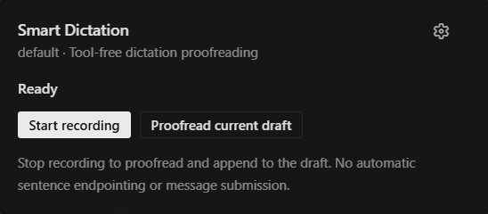

# Smart Dictation

A community Hermes plugin for **local speech recognition and bounded, tool-free proofreading**. New installations use Hermes' existing microphone through the `smart_dictation` speech provider. The existing **Contextual dictation** workflow remains available for selected conversation context, review, original-text recovery and protected insertion.

The plugin does not submit chat messages. Ordinary native dictation inserts text; separately selected Hermes voice-conversation modes keep their own submission behavior. Native follows stock Hermes insertion/undo, not Contextual's stricter session/unchanged-draft guarantees.



*Contextual recording/review interface. Native uses Hermes' built-in microphone; the plugin's Voice options button opens guidance, not another recorder.*

## Requirements and installation

- Hermes **0.23.0 or newer**, with the Desktop app. The compatible-host fixtures pin released revision `2bd378ed1b8d6bf2192cb26e0a55ff3091e6bd19`; unreleased plugin-RPC APIs are not required.
- Select `stt.provider: smart_dictation` for Native after reviewing the provider change. Contextual accepts `local` or `smart_dictation` and performs raw ASR directly, without double correction. An already-cached faster-whisper model is required. Normal dependency admission installs libraries, **not model weights**. Missing/partial model or tokenizer files are errors, never an automatic download, runtime installer or cloud-STT fallback.
- A configured correction provider/account in Hermes. Choose a lightweight model for this auxiliary task; no vendor/model/language-specific default is shipped.
- Local faster-whisper support follows its native wheels: Windows x64, supported Linux architectures and Apple Silicon macOS. Windows ARM64, Intel macOS and Android are excluded by the dependency marker; no support is claimed for their local decoder.

Before catalog listing, install this public repository with an exact reviewed commit:

```sh
hermes plugins install https://github.com/metamindedu/hermes-smart-dictation --ref <full-reviewed-commit-sha> --enable
```

For a named local profile, use `hermes --profile <name> plugins install ... --ref <sha> --enable`. Follow Hermes' normal dependency/activation prompts. Python registration/backend activation is **per profile**; the Desktop JavaScript asset is **app-wide**. Other and future profiles are not automatically enrolled. A submitted catalog PR is not a listing until maintainers merge it.

## First use: prepare the profiles you choose

Open **Voice options** or plugin settings. The guide works without an enabled Python backend or focused conversation. Select local profiles, optionally include Native correction preparation, then **copy the request and send it yourself** to your Hermes agent with access to the intended computer. Selection edits the request only: it does not activate profiles, insert a draft, invoke an agent or send a message. If discovery fails, the generic request asks the agent to list and confirm targets first.

The agent should use normal installation/activation and configuration admission, preserve explicit OFF/other providers/models/accounts, and report prerequisites separately per target. Later profiles are not automatically enrolled. A visible panel or saved UI preference is not proof of backend readiness.

### Native microphone (fresh-install default)

After reviewing the old-to-new provider transition, the current default profile can select the provider through normal configuration:

```sh
hermes config set stt.provider smart_dictation
```

The tested 0.23.0 STT picker can omit plugin rows even when dispatch works. Use the supported configuration procedure/copied request, not an invented dropdown. Preserve local model/device/language settings and an explicit STT OFF unless separately approved. **Provider selection applies to other voice processing in that profile, including gateway voice input; it is not current-Desktop-conversation-only.**

Native correction starts **OFF**. Installation, provider selection and UI mode are not transcript-transmission or paid-call consent. After explicit profile-wide consent, its own configuration shape is:

```yaml
plugins:
  entries:
    smart-dictation:
      settings:
        native:
          correction_enabled: true
          consent_version: native-v1
```

Apply through normal configuration procedures; do not overwrite existing config with this partial example. Model download, paid tests and microphone capture need separate approval. The copied preparation request makes these boundaries explicit.

Use the built-in Hermes microphone. Keep the intended conversation selected until transcription finishes. Native has no selected session context, original/corrected comparison or plugin restore after success; use Contextual when those guarantees matter. If enabled correction fails or is skipped after ASR, **a fixed warning line and the complete original transcript are inserted as text**. Review/remove the warning before sending. Deliberately disabled correction returns plain recognition; silence stays empty.

**Check setup for this profile** reads provider selection, library/cache metadata and correction consent only. It does not load a decoder, record audio, run inference or prove actual model/provider access.

### Contextual dictation

Existing saved context/recording preferences stay in Contextual until explicitly changed. Fresh/absent preferences use Native. Empty/malformed parsed preferences use manual Contextual guidance without repair writes. Unparseable serialized storage is returned as a fallback by the public SDK and cannot be distinguished from absence; reading it never writes or starts recording. Saving a workflow changes the toolbar UI only, not provider selection/correction consent. Inactive values and unrelated own settings are retained; mode changes are blocked during active/pending plugin operations.

Use **Record** beside the composer for one-click dictation, or its arrow to open the panel without recording. Click **Stop and proofread** to transcribe, correct and append to the original draft. **Proofread current draft** operates on text already in the input. A result applies only while its connection, profile, conversation, operation generation and original draft remain unchanged.

In Contextual, **Start recording from the toolbar** retains its independently configured default. Explicit OFF is preserved; malformed values fail closed. It never starts the plugin recorder in Native mode. Only an explicit Contextual recording-button gesture can start capture after owner/context checks and microphone permission. Mount, install, settings, saving, mode switching, palette and the panel-only arrow never acquire the microphone. Each mounted composer has its own popup owner.

### Choose the correction model in Hermes

The plugin's **Open Hermes model settings** button opens the native model page at the **Smart Dictation correction** auxiliary row. Select the intended connection/profile and check the native save targets before applying. Select a lightweight correction model and the lowest suitable reasoning level offered by Hermes. Do not change the main-model row unless that is what you intend.

Hermes owns model/provider/account selection, supported effort choices, validation, cost confirmation and saving. This plugin neither writes model settings nor replaces credentials, endpoints or advanced overrides. Model settings are separate from the plugin's recording/context preferences. Unpinned auxiliary settings may inherit the main route; provider default is not necessarily reasoning OFF. Catalog availability is not proof of entitlement, speed or a successful request.

## Neutral defaults and optional reference context

Custom instructions start **empty and disabled**. SOUL, title and history are initially OFF. No language, product name, organization or personal style is baked into correction preferences. UI has English fallback and Korean localization; saved preferences are preserved.

These are **Contextual-only** sources, not imported into Native. Each is independently selectable; OFF prevents its fetch and transmission:

- Additional correction instructions: up to 2,000 characters.
- The captured owner's saved SOUL.md: first 4,000 characters, as untrusted reference.
- The captured conversation title: up to 300 characters.
- Recent completed user/final-assistant turns: 1–5 turns, up to 6,000 characters. Tools, system/developer messages, hidden reasoning and incomplete turns are excluded. Native canonical display `text` is used, not private sidecars.

The fixed proofreader contract preserves meaning, language, negation, numbers, names and paths, and prohibits translation, answering or execution. Spoken text and reference fields are data, not permission to follow embedded commands. The history RPC reads the display transcript before filtering, so long conversations may take longer. A new conversation may have no title/history.

## Local transcription policy

Only the owner's explicitly configured local provider is used; a saved STT OFF is respected. The backend freezes a restricted copy of effective local settings before dispatch. Language follows Hermes' local/global configuration, including host defaults; clear both language hints for automatic detection. Legacy environment-only language overrides are not read. Device/compute settings are honored; unsupported runtime/device failures do not trigger another provider. This release uses public faster-whisper APIs, not Hermes' private decoder or error-string retry helpers. Its confidence filter drops a segment only when `no_speech_prob` is strictly above the configured threshold (default 0.6) AND `avg_logprob` is strictly below its threshold (default -1.0). VAD defaults ON with a 500 ms minimum silence; decoding uses beam size 5 without previous-text conditioning.

Decoding happens in an owner-bound worker; its lazy segment generator is consumed there. Cached models are partitioned by owner/effective settings. One decode per owner, bounded result retention and scheduled two-minute expiry limit background state. Cancellation discards a result but cannot necessarily interrupt a decoder already running.

The Contextual recorder stops at three minutes. File/retained-data bounds are not an OS sandbox, adversarial-codec peak-memory bound or hard C++ deadline. Native forwarding can buffer before plugin validation, so no pre-buffer Gateway ingress guarantee is claimed. There is no plugin-provided automatic sentence endpointing or continuous hands-free mode.

Local means the **selected Hermes backend host**. Core transports such as messaging/remote Desktop can first deliver audio there; this provider does not call cloud STT. Contextual recording supports local connections only. Native processes the core-supplied file without another upload/job server; Contextual keeps its bounded async jobs and raw-only ASR, without double correction.

## Correction, cost and privacy

Native uses the original registration context's public **`ctx.llm.complete`** on its owned correction task, with bounded transcript-only input and no new route-override/trust grants. Contextual uses owner/session-routed **`llm.oneshot`** with the selected bounded references. The plugin supplies no tool schemas, constructs no agent and dispatches no tools/skills. An explicit auxiliary model can override the conversation model in Contextual.

With a remote model, the transcript and selected context leave the device for that provider. Hermes may apply native recovery, credential rotation or fallback; one plugin invocation is not necessarily one network attempt, a frozen payer or a hard cost ceiling. The plugin does not automatically repeat uploads or correction calls. Polling retrieves the existing transcription job only.

The 0.23 Contextual one-shot envelope does not expose final-provider/tool-call/finish-reason provenance and can fall back to reasoning text when visible content is empty. The Native facade likewise omits mixed-tool/finish-reason details. No tool dispatcher is supplied, but arbitrary host/provider extensions are not certified sandboxes. Review corrections; Native failures preserve labelled raw, while Contextual failures retain reviewable raw without silently applying it. Client timeout is not proof of server cancellation or zero billing.

Preferences alone are saved in plugin storage. Transcript, correction and restore snapshots stay in volatile app memory; job-query data is removed after use. Temporary audio uses the owner's scratch directory and is removed in cleanup on normal/error paths. A crash or OS cleanup failure can leave a temporary file. Server job text is scheduled to expire two minutes after completion. Hermes/provider logging and retention policies are separate.

In Contextual, **Use original text** and **Restore the previous draft** are owner/draft-fenced, not global undo. Foreign captured results are not displayed as the current conversation's results. A late permission callback releases only its own attempt, never a newer stream. Automatic future-profile enrollment, remote installation and hidden account/provider substitution are unsupported. Core owns Native temporary-file cleanup and ordinary draft persistence; crash/OS cleanup and host/provider logging remain separate boundaries.

## Upgrades and development

Backend registration, Python API adoption and app-level JavaScript loading have distinct lifecycles. Already-mounted in-process routes may require an **idle restart of their actual owner**; registry reload/file replacement alone is not proof. The manifest uses a versioned host API entry. Never restart a busy shared Gateway or hot-swap a recording/permission wait. Preserve explicit enable/disable choices and local edits. The plugin has no self-updater.

Development uses Node 26 and an isolated Python test environment:

```sh
npm ci --ignore-scripts --no-audit --no-fund
npm test
npm run build
uv run --isolated --with pytest --with fastapi --with httpx --with python-multipart python -m pytest -q --basetemp=<owned-scratch-directory> tests
```

Set `HERMES_NATIVE_SOURCE=/path/to/the-compatible-hermes-checkout` for native composer, controls, query-client and settings contracts; otherwise those cases explicitly skip. Native-control screenshots use synthetic data and declared host/theme/clipboard substitutions, not installed-app, physical-microphone, latency or real-provider certification. CI uses no credentials, paid inference or physical microphones. See [the Native acceptance criteria](docs/NATIVE_FIRST_ACCEPTANCE.md).

See [CONTRIBUTING.md](CONTRIBUTING.md), [SECURITY.md](SECURITY.md), and [catalog evidence](docs/CATALOG_READINESS.md). Licensed under [MIT](LICENSE). This is a community project, not a Nous-maintained or automatically approved catalog entry.
